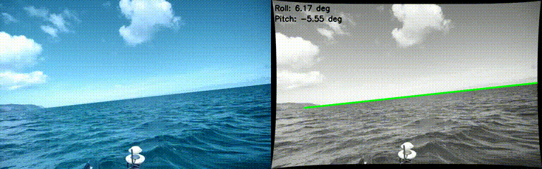
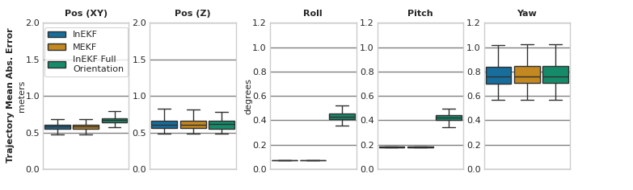
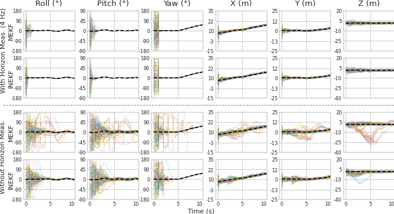
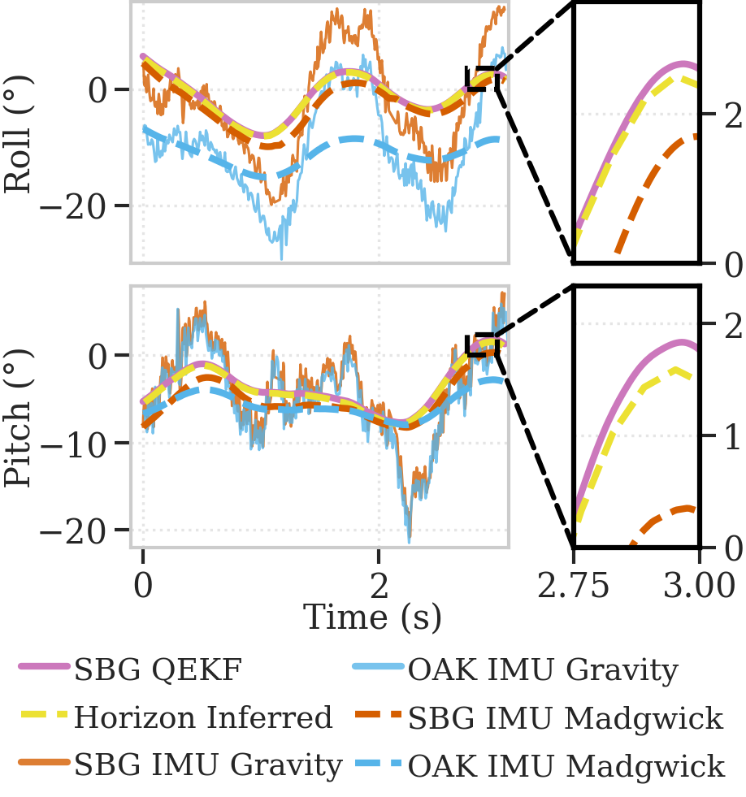
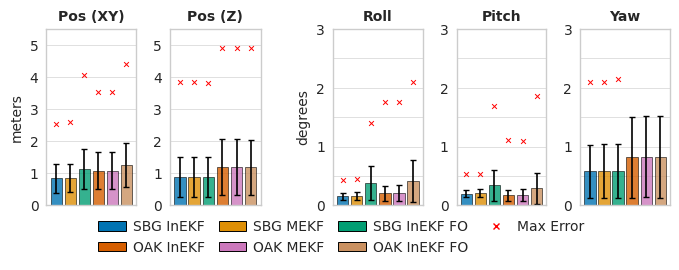

<!-- # Surface_Vessel_InEKF -->
# Accompanying repository for: Invariant Extended Kalman Filter for Autonomous Surface Vessels with Partial Orientation Measurements

## Overview
The primary contribution of this work is a novel framework for **partial orientation integration** within the Invariant Extended Kalman Filter (InEKF). While traditional InEKF implementations require full attitude measurements to maintain symmetry properties, our method allows for the direct fusion of decoupled orientation components. We demonstrate the effectiveness of this approach by utilizing vision-based horizon measurements to provide robust roll and pitch corrections for an Autonomous Surface Vessel (ASV), significantly improving state estimation stability.



The values shown above are the raw, unfiltered estimates of the roll and pitch from observing the horizon, which are then integrated into the InEKF.

## Quick Start
To set up the environment and retrieve the experimental datasets, execute the following commands:

```bash
# Install required Python libraries
pip install -r requirements.txt

# Download and extract experimental data into the data subfolder
wget -P data/ [https://your-data-link.com/maritime_dataset.zip](https://your-data-link.com/maritime_dataset.zip)
unzip data/maritime_dataset.zip -d data/
```

Run the following python scripts to generate new data and their respective figures.

If you just want to reproduce the figures in the paper using the data provided, run `python3 helpers/function_helpers.py`

## Key Research Contributions
### 1. Partial Orientation Integration in the InEKF
Standard Invariant Extended Kalman Filter (InEKF) formulations typically require full $SO(3)$ attitude measurements to maintain the symmetry properties of the filter. Our framework introduces a novel method to integrate partial orientation measurements—specifically roll and pitch derived from horizon observations, or yaw only—directly into the Lie algebraic error state.

As illustrated in the figure below, this approach utilizes all available geometric information by decoupling the observable attitude components. This allows the filter to benefit from the vision-based constraints of the horizon without requiring an external heading source for every update. This represents a significant advancement over traditional InEKF implementations that were previously restricted to full-attitude measurements.



### 2. Convergence Consistency
While steady-state accuracy is a common metric, the reliability of a navigation filter is defined by its ability to recover from significant initial state errors or "cold starts."

In this next figure, we demonstrate that while the InEKF and MEKF achieve nearly identical Mean Absolute Error (MAE) during steady-state operation (shown above), the InEKF maintains superior convergence properties. Due to its state-independent linearization (linearization is decoupled from the current state estimate), the InEKF reliably corrects large initial offsets where the MEKF may exhibit sluggish convergence or instability.



### 3. Real-World Validation and Assessment of Horizon-inferred Roll & Pitch Accuracy
While prior works have qualitatively observed that horizon-based tracking is more robust than raw IMU integration, this study provides a rigorous numerical characterization of the error. We validated our vision-based observations against industrial-grade ground truth (SBG Ellipse-D) in real-world maritime environments.



Our analysis confirms that horizon-derived attitude acts as a powerful "equalizer" for low-cost hardware. By providing a stable geometric constraint, the algorithm allows consumer-grade sensors (like a low cost BNO086 IMU) to achieve mean attitude accuracy comparable to industrial-grade units, effectively mitigating the stochastic drift and noise floor inherent in lower-cost inertial sensors.



## Citation
If you utilize this framework or dataset in your research, please cite us:
```
@article{benham2026horizon,
  title={Insert finalized title here},
  author={Benham, Derek R. & Potokar, Easton & Mangelson, Joshua G.},
  journal={TBD},
  year={2026}
}
```

## TODO
[ ] Prune ROSBAGs to only include relevant data

[ ] Upload data to be downloaded via wget
 
[~] Clone repo on different computer and verify install

